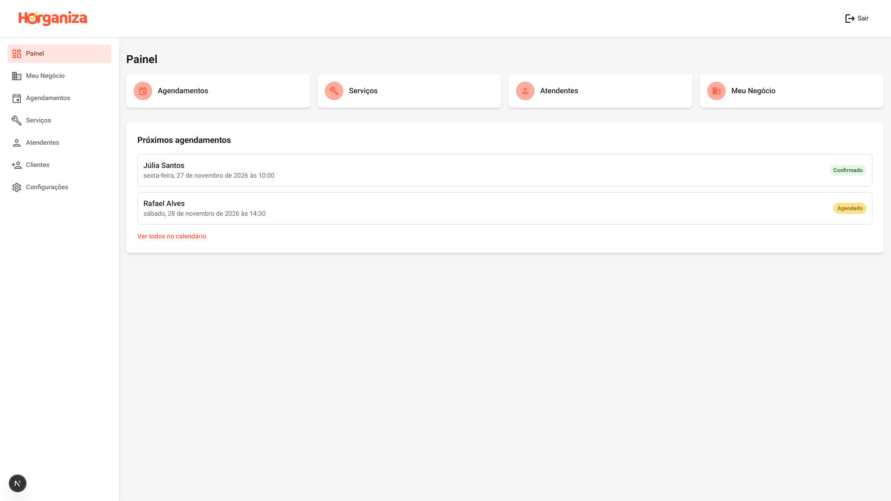
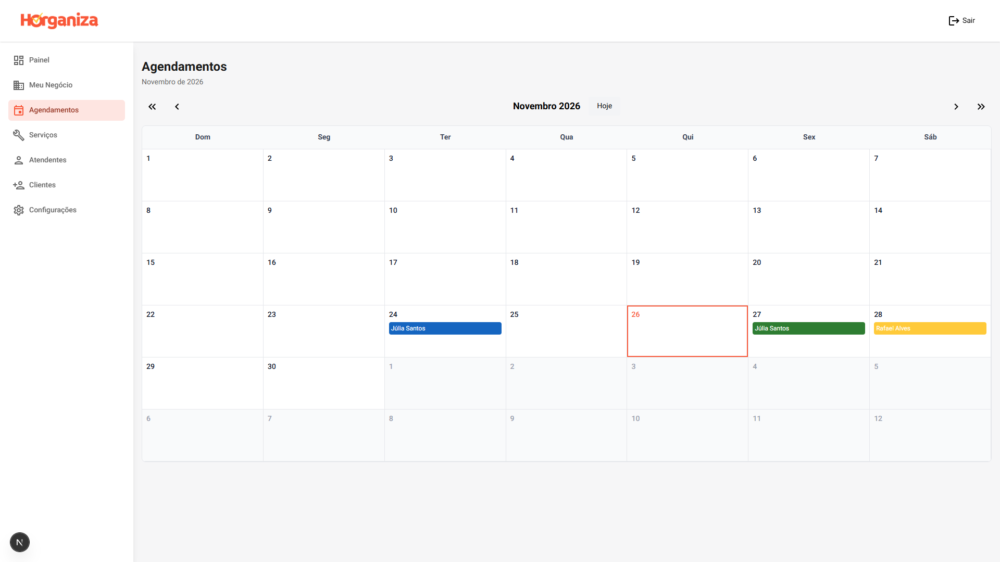
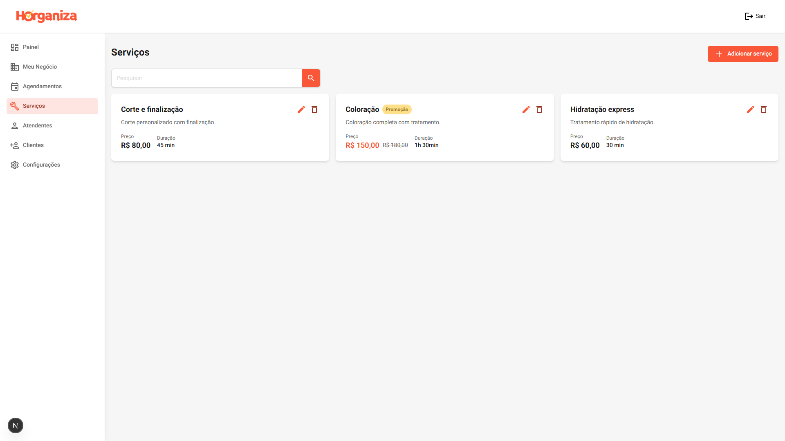
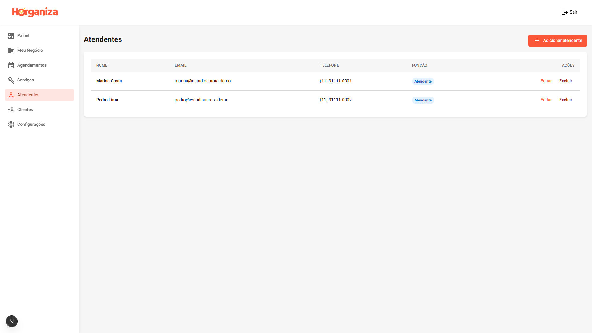
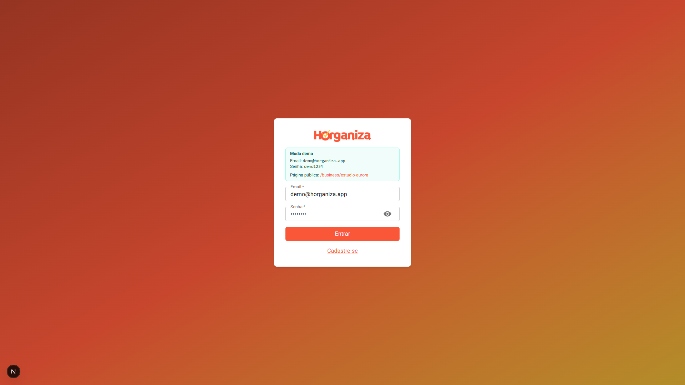
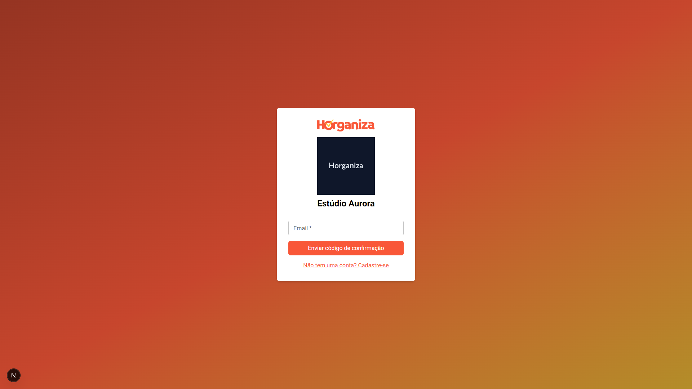

# Horganiza

**Painel de agendamentos** para negócios de serviço.

O estabelecimento gerencia equipe, serviços, clientes e a agenda num único lugar. O cliente agenda pela página pública do negócio — sem app separado, sem planilha.

<p align="center">
  <strong>demo</strong>
  &nbsp;·&nbsp; frontend público
</p>

> Esta publicação é uma **demo** com dados fictícios (Estúdio Aurora). Não é o ambiente de produção.

<p align="center">
  
</p>

## O que é

Negócios de serviço perdem tempo em WhatsApp, planilha e calendário solto. O Horganiza concentra a operação do dia a dia e entrega uma vitrine de booking para o cliente final.

| É | Não é |
| --- | --- |
| Painel do estabelecimento | Marketplace multi-loja |
| Agenda, serviços, equipe e clientes | ERP financeiro completo |
| Página pública de agendamento por negócio | Rede social |
| Demo frontend com dados mockados | Backend de produção neste repositório |

<br />

<table width="100%">
  <tr>
    <td width="48%" valign="top">
      
    </td>
    <td width="4%"></td>
    <td width="48%" valign="top">
      
    </td>
  </tr>
</table>

<br />

<table width="100%">
  <tr>
    <td width="48%" valign="top">
      
    </td>
    <td width="4%"></td>
    <td width="48%" valign="top">
      
    </td>
  </tr>
</table>

<p align="center">
  
</p>

## O que já dá para usar na demo

- **Painel** — atalhos e próximos agendamentos
- **Agendamentos** — calendário mensal com status (agendado, confirmado, concluído, cancelado)
- **Serviços** — cadastro, preço, duração e promoção
- **Atendentes** — equipe e vínculos ao negócio
- **Clientes** — lista de clientes do estabelecimento
- **Meu Negócio** — identidade visual e dados de contato
- **Página pública** — `/business/estudio-aurora` (fluxo de autenticação do cliente)

## Escopo desta demo

O que **não** faz parte deste ciclo público:

- Backend e banco de produção
- Persistência real entre cold starts (o mock vive em memória)
- Pagamentos, mensageria ou notificações
- Multi-tenant completo além do negócio seed

Estados vazios e credenciais de demo ficam explícitos na interface.

## Como o dado flui (produto)

```text
Cliente / painel
        ↓
   Next.js (UI)
        ↓
   API REST
        ↓
  PostgreSQL
```

Na **demo deste repositório**, sem `API_BACKEND_URL`, as rotas `/api/*` são atendidas por handlers mock na própria app (`src/mocks` + `src/app/api`). Com `API_BACKEND_URL`, o rewrite aponta para a API real.

## Stack

| Camada | Tecnologia |
| --- | --- |
| Interface | Next.js (App Router), React, TypeScript, Tailwind CSS, Material UI |
| Calendário | FullCalendar |
| HTTP | Axios |
| Qualidade | ESLint, TypeScript estrito, Jest + Testing Library |

## Design

Tema claro, laranja como cor primária do produto, tipografia Roboto, layout com sidebar no painel e páginas de auth em full-bleed. A metáfora é um **painel operacional** — limpo, legível, sem dashboard de vanity metrics.

## Este repositório

Frontend público em modo demo: código Next.js com API mockada e capturas. O backend de produção **não** está aqui.

**Login demo:** `demo@horganiza.app` / `demo1234`  
**Página pública:** `/business/estudio-aurora`
